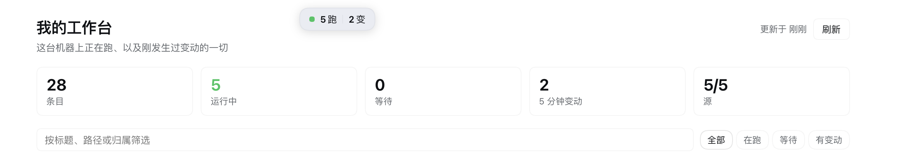

# dsh-localdesk

A read-only observatory for your machine: what is running right now, and what just changed.



## What it shows (0.4.1 / P4)

| Section | Source | Per row |
| --- | --- | --- |
| Sessions | live DSH Agents + each Session's own log | directory, model, turn, last activity; click to open |
| Background jobs | `jobs` registry events (all owners) | command, owner Session, progress, output size |
| Scheduled tasks | `schedule.catalog()` | title, timing, next run, target Session |
| Goals | `goals.get(agent)` | objective, phase, rounds |
| Team tasks | `agentTeams.listTasks(agent)` | subject, status, owner, blocked |
| Codex sessions | `~/.codex/sessions/**/rollout-*.jsonl` (head + tail only) | project, event count, CLI version, provider, running/idle/done |
| WeChat channel | DSH's own `~/.dsh/channel-wechat/peer-sessions.json` | peer, linked Session; click to open |
| App data | mtimes under `.claude`, `.cursor`, Kim's data dirs | which app data changed, when, which child moved |
| Local apps | allowlisted `pgrep` | app name, matching processes; click to bring it forward |

## Where it lives

- Sidebar entry **My desk** (「我的工作台」) and its main panel.
- A frame-wide island at the top of the window: collapsed it shows run / wait / changed counts and refreshes every 10s; click it for the top five items and an **Open desk** button. It hides itself when there is nothing to show, refreshes every 2.5s while open, and closes on Esc or an outside click.
- One read-only route `GET /dsh-localdesk/state` behind the same connection trust as the app.
- One action route `POST /dsh-localdesk/open`, used only when you click a row whose target is a local app. It accepts an allowlisted app name or an `http(s)` URL, never a shell string.

## Filtering

The desk has a search box (title, path, owner, meta, tags) and status chips (All / Running / Waiting / Changed). Filtering is client-side: the summary above stays global, section counts show what survived the filter, and an empty result says so instead of hiding the page.

## Boundaries

- **Read-only**: no Session event is appended, no task state changes, nothing leaves the machine.
- **This process, this machine**: DSH items come from the current process; Codex, app-data and app rows come from the machine. Durable Sessions from other DSH processes are not listed yet (P2 scope kept this out).
- **No content reads**: only metadata — titles, states, timestamps, counts.
- **Kim is not read**: its local databases are SQLCipher-encrypted; only the separate `mycli` tool can open them. The Kim row you see comes from the generic app-data watcher, not from decryption.
- Plugin subprocesses are not sandboxed by DSH, so every command this plugin runs is fixed-argv and allowlisted (see `docs/DECISIONS.md` D8).

## Layout

- Sources live in `index.js` behind one `Item` contract (see `docs/CONTRACTS.md`); the client renders that contract and nothing else.
- `test/probe.mjs` runs both halves against fixtures and a fake Cordis context: `node test/probe.mjs` (64 checks).
- The island is client-only; it reads the same `/state` route with a lower cadence while collapsed.
- The screenshot above is a real window capture; it is cropped to the header area so no local paths, workspace names, or session content appear in it.

## Compatibility

- Requires Node `^22.19.0 || >=24.0.0` (the DSH app runtime).
- Hard dependencies: `webServer`, `connection`, `agents`. Without them the plugin does not activate.
- Optional services: `jobs`, `schedule`, `goals`, `agentTeams`, `subprocess`. A profile that lacks one degrades per source — that source reports `unavailable`/`error`, every other source keeps working (the probe covers exactly this).
- A source that fails at scan time is isolated: its card shows an error, the rest of the desk still renders.
- The Host reports its version through `/state`; if the page is newer than the Host half (a client update without a restart), the desk says so and asks for a restart instead of silently showing an older source set.

## Install

Published as **`dsh-localdesk`** on npm:

```bash
# In DSH: Plugins > Add plugin, then install the published package,
# or install this directory for local development.
```

Ignore the `0.0.0-stage` placeholder version that npm creates for a brand-new package name; `latest` points at the real release.

## License

MIT
